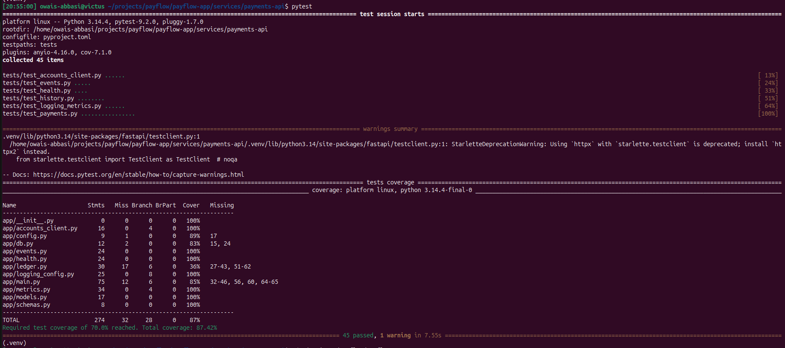

# 1.3 — payments-api (FastAPI)

| Field | Value |
|---|---|
| Phase | 1 — The PayFlow application |
| Date | 2026-11-06 |
| Status | Done |

## Goal
Build the service that moves money: a transfer between two accounts that is atomic, safe under
concurrency, announces itself to the rest of the system through Redis, and is observable through
metrics, health probes and JSON logs.

## What I did
1. `POST /payments`: validates the body, asks accounts-api over HTTP whether both accounts exist
   (2 s timeout; 404 if missing, 503 if accounts-api is unreachable).
2. Made the transfer one PostgreSQL transaction: lock both rows with `SELECT ... FOR UPDATE`
   in UUID order, check the balance, debit, credit, insert into `transactions`. 409 on
   insufficient funds, and the rollback leaves nothing behind.
3. After the commit, published `payment.completed` to the Redis stream `payflow:payments`
   (`XADD ... MAXLEN ~ 10000`). If Redis is down the payment still succeeds.
   ```bash
   docker run -d --name payflow-redis -p 6379:6379 redis:7
   ```
4. Business metrics: `payments_total`, `payments_failed_total{reason}`, `payment_amount`
   histogram (PKR buckets), `events_publish_failed_total`.
5. Copied accounts-api's JSON logging, request middleware and probes. `/readyz` treats
   PostgreSQL as a hard dependency (503) and Redis as soft (reported, still 200).
6. `GET /payments?account_id=...&limit=...`: history, newest first, capped at 200.
7. 45 unit tests with accounts-api, the ledger and Redis faked; no Docker needed.
   ```bash
   docker stop payflow-pg payflow-redis
   pytest
   ```

## How I verified it
Race test: 10 transfers of 100 at the same time from an account holding 500.
```text
$ seq 10 | xargs -P10 -I{} curl ... /payments | sort | uniq -c
      5 201
      5 409
$ bal $C; bal $D
0.00
500.00
```

Redis stopped during a payment: 201 returned, one JSON error line, counter incremented.
```text
{"level": "ERROR", "logger": "app.events", "message": "event publish failed",
 "payment_id": "715cd8e0-...", "exception": "Traceback ..."}
events_publish_failed_total 1.0
```

Readiness:
```text
redis down     -> {"status":"ready","database":"up","redis":"down"}          200
postgres down  -> {"status":"unavailable","database":"down","redis":"up"}    503
```

Unit tests:
```text
45 passed
TOTAL   <stmts>   <miss>   ...   <87%>
```


`ledger.py` is uncovered on purpose: its locking is proven by the race test above and will be
covered by the integration tests in 7.2.3.
