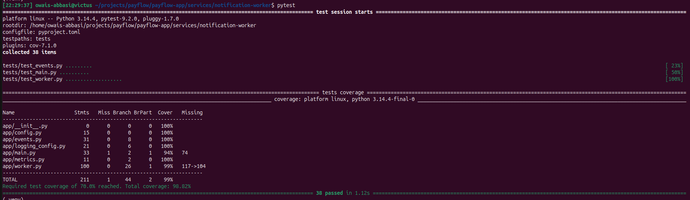

# 1.4 — notification-worker (Python)

| Field | Value |
|---|---|
| Phase | 1 — The PayFlow application |
| Date | 2026-11-06 |
| Status | Done |

## Goal
Build the service on the other end of the `payment.completed` event: a background worker that
reads payments from a Redis Stream and sends a "notification" (a log line, standing in for
email/SMS). It must not lose events when it crashes, must stop cleanly when Kubernetes stops
the pod, and must be observable through metrics.

## What I did
1. Created `services/notification-worker` with the same patterns as payments-api:
   pydantic-settings config (no defaults for `REDIS_URL` and `HOSTNAME`, so a missing value fails
   at startup), JSON logs with `SERVICE_NAME = "notification-worker"`, prometheus-client, ruff,
   pytest with a 70% coverage gate.
2. Consumer group on the stream from `docs/architecture.md`:
   - stream `payflow:payments`, group `notification-workers`, consumer name = `HOSTNAME`
   - `XREADGROUP ... >` with a 2 s block, then log "notification sent", then `XACK`
   - group created with `id=0`, so events published before the first worker ran are not skipped
3. At-least-once delivery when a worker dies between reading and acking:
   - on startup the worker re-reads its own pending entries (same pod name after a container restart)
   - every 60 s it takes over entries another consumer left unacked for 60 s (`XAUTOCLAIM`),
     which covers a pod that is gone for good
4. Bad messages (not JSON, wrong type, unknown `version`, wrong shape) are logged, counted in
   `events_invalid_total{reason}` and acked, so one bad entry can't block the queue.
5. Redis outages are retried with backoff (1, 2, 4 … 30 s) and counted in `redis_errors_total`;
   if Redis comes back empty, the worker recreates the group.
6. SIGTERM / SIGINT set a stop flag; the loop finishes the batch it already read, acks it, closes
   Redis and the metrics server, and exits 0.
7. Metrics on a side port (9100): `notifications_sent_total`, `events_invalid_total{reason}`,
   `redis_errors_total`.
8. 38 unit tests with fakeredis, no Docker needed.

Running it locally (three services + Redis + PostgreSQL):
```bash
docker start payflow-pg payflow-redis
# terminal 1: accounts-api   (uvicorn app.main:app --port 8001 --no-access-log)
# terminal 2: payments-api   (uvicorn app.main:app --port 8002 --no-access-log)
# terminal 3: the worker
cd ~/projects/payflow/payflow-app/services/notification-worker
source .venv/bin/activate
cp --update=none .env.example .env
set -a; source .env; set +a
python -m app.main
```

## How I verified it

**1.4.1 — a payment produces a notification.** Two accounts, one transfer of 250.00:
```text
$ curl -s -X POST localhost:8002/payments ... | jq
{
  "id": "4de698b1-d620-4865-913e-f487f33f18ca",
  "amount": "250.00",
  "currency": "PKR",
  "status": "completed",
  ...
}
```
Worker log, same `payment_id`, about 13 ms after the payments-api response:
```text
{"level": "INFO", "service": "notification-worker", "message": "notification sent",
 "entry_id": "1793985646391-0", "payment_id": "4de698b1-d620-4865-913e-f487f33f18ca",
 "amount": "250.00", "currency": "PKR", ...}
```
Nothing left unacked:
```text
$ docker exec payflow-redis redis-cli XPENDING payflow:payments notification-workers
0
```

**1.4.2 — clean shutdown.**
```text
$ kill -TERM 104472
{"message": "shutdown requested", "signal": "SIGTERM", "timestamp": "...17:24:27.467..."}
{"message": "worker stopped",                          "timestamp": "...17:24:29.824..."}
$ echo $?
0
```
2.4 s from SIGTERM to exit (one 2 s Redis read finishing), far inside Kubernetes' 30 s grace
period. Ctrl+C (SIGINT) took 1.8 s, same path.

**1.4.3 — metrics.** Before a payment (every reason starts at 0):
```text
notifications_sent_total 0.0
events_invalid_total{reason="missing_payload"} 0.0
events_invalid_total{reason="invalid_json"} 0.0
events_invalid_total{reason="unknown_type"} 0.0
events_invalid_total{reason="unsupported_version"} 0.0
events_invalid_total{reason="invalid_schema"} 0.0
redis_errors_total 0.0
```
After one payment of 100.00, and after pushing a broken entry by hand:
```text
notifications_sent_total 1.0

$ docker exec payflow-redis redis-cli XADD payflow:payments '*' payload 'oops'
events_invalid_total{reason="invalid_json"} 1.0
{"level": "ERROR", "message": "invalid event dropped", "reason": "invalid_json", ...}
```

**1.4.4 — unit tests** (Redis stopped, to prove they don't need it):
```text
38 passed in 1.12s
TOTAL   211   1   44   2   99%
Required test coverage of 70.0% reached. Total coverage: 98.82%
```


Merged as payflow-app PR #6.

## Interview angle
**Q: How do you make sure a worker never loses a message if its pod crashes?**
A: Use a Redis Stream consumer group and ack only after the work is done. An entry read but not
acked stays in the group's pending list. If the same pod restarts, it re-reads its own pending
entries on startup; if the pod is gone, another worker takes them over with `XAUTOCLAIM` once they
have been idle for 60 s. The trade-off is that a message can be processed twice, so the handler has
to be safe to repeat (here, a duplicate log line is acceptable).
