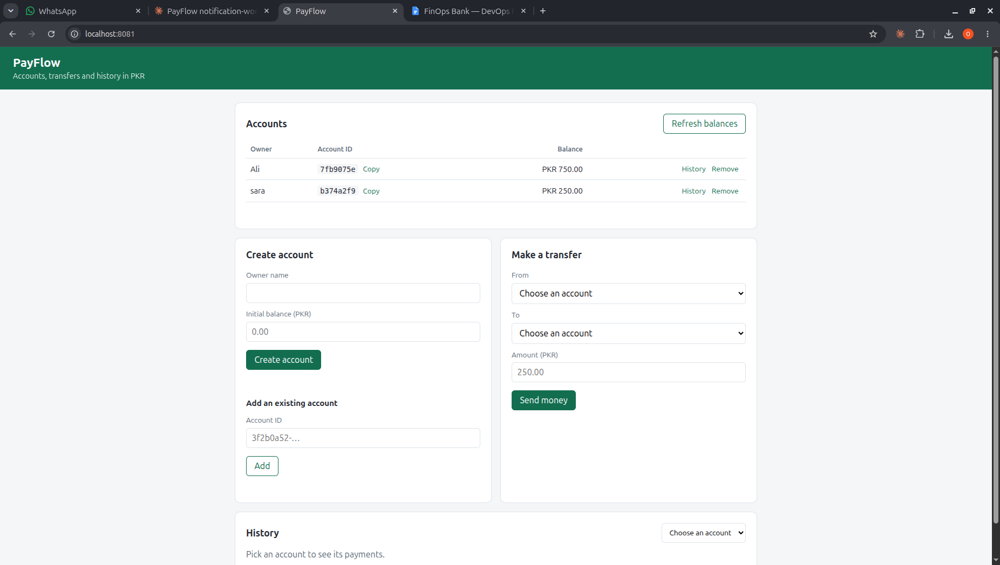

# 1.5 — frontend

| Field | Value |
|---|---|
| Phase | 1 — The PayFlow application |
| Date | 2026-11-06 |
| Status | Done |

## Goal
Give PayFlow a user-facing page: create accounts, send money, see history. It has to call the
APIs through relative `/api/...` paths, so the same page works behind the Kubernetes Ingress
on kind and on EKS without any code change or CORS setup.

## What I did
1. Built one static page in `frontend/` with no framework and no build step:
   `index.html` (layout and forms), `app.js` (API calls and rendering), `styles.css`.
2. Features:
   - create an account (owner name, optional initial balance)
   - add an existing account by its ID
   - accounts table with live balances, copy-ID, history and remove buttons
   - transfer form (from, to, amount) that shows the API's own error on failure
   - history for one account: date, sent/received, counterparty, amount
3. All API calls use relative paths:

   | Browser calls | Goes to |
   |---|---|
   | `/api/accounts...` | accounts-api `/accounts...` |
   | `/api/payments...` | payments-api `/payments...` |

4. Added `frontend/dev/nginx.local.conf`: for local development only, it serves the page and
   does what the Ingress will do later (route by path, strip `/api`). It is not part of the
   container image; that comes in 2.1.
5. Ran it locally with the unprivileged nginx image, the same base the real image will use:
   ```bash
   cd ~/projects/payflow/payflow-app/frontend
   sed 's/listen 8080;/listen 8081;/' dev/nginx.local.conf > /tmp/payflow-nginx.conf
   docker run --rm --name payflow-frontend --network host \
     -v "$PWD":/usr/share/nginx/html:ro \
     -v /tmp/payflow-nginx.conf:/etc/nginx/conf.d/default.conf:ro \
     nginxinc/nginx-unprivileged:1.27-alpine
   ```
   with accounts-api on 8001, payments-api on 8002 and the notification-worker running.

## How I verified it
In the browser at `http://localhost:8081`:
- created two accounts (one with an initial balance, one defaulting to 0)
- made a transfer: both balances updated and the worker logged "notification sent"
- tried a transfer larger than the balance: the page showed "insufficient funds" from payments-api (409)
- picked an account under History: the transfer appeared as Sent / Received
- reloaded the page: the accounts list was still there (localStorage)
- in DevTools → Network, the transfer request went to `http://localhost:8081/api/payments`
  (same origin as the page), and payments-api logged it as `/payments`, so the `/api`
  prefix was stripped on the way



Merged into payflow-app main from the `feat/frontend` branch.

## Problems and fixes
| Problem (error message) | Cause | Fix |
|---|---|---|
| `bind() to 0.0.0.0:8080 failed (98: Address in use)` | A host Jenkins (`java`, started at boot) already listens on 8080 | Served the page on 8081 with a temporary copy of the dev config (`sed ... > /tmp/payflow-nginx.conf`); the repo keeps 8080 |
| `can not modify /etc/nginx/conf.d/default.conf (read-only file system?)` | The image tries to add IPv6 listening to the config, but I mounted it read-only on purpose | Nothing to fix; harmless |

## What I learned
- **Same-origin API paths** remove CORS completely: the browser only ever talks to the host
  that served the page, and the Ingress (or nginx locally) decides which service gets the request.
- **Path-based routing with prefix stripping:** the services serve `/payments`, the browser calls
  `/api/payments`, and the proxy in between rewrites it. The services never need to know about `/api`.
- **Ports inside vs outside containers:** 8080 clashed only on my laptop because `--network host`
  shares the host's ports. In Kubernetes every pod has its own network, so the frontend can listen
  on 8080 next to anything.

## Interview angle
**Q: Your frontend and APIs are separate services. How does the browser reach them without CORS?**
A: The page only uses relative paths like `/api/payments`, so every request goes to the same
host that served the page. An Ingress routes by path (`/api/accounts` to accounts-api,
`/api/payments` to payments-api) and strips the `/api` prefix. To the browser it is one origin,
so no CORS headers are needed, and the same page works on any domain without a rebuild.
